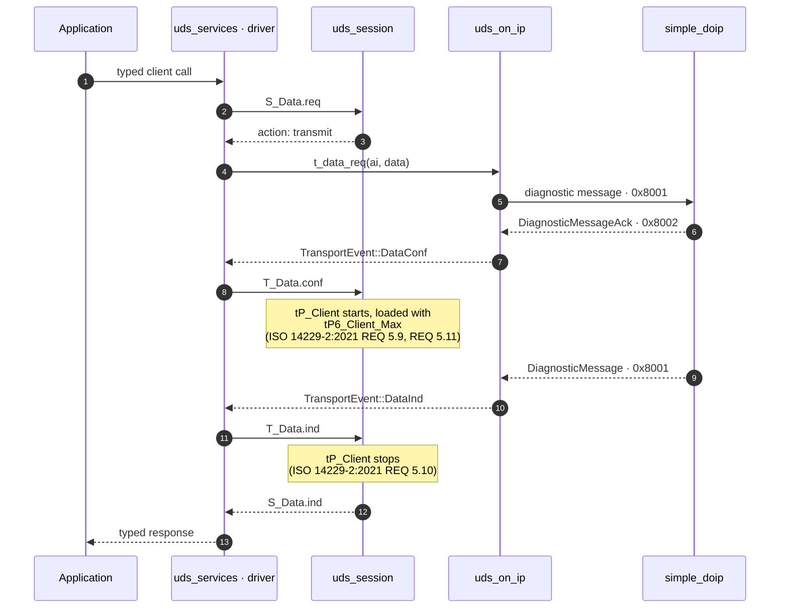
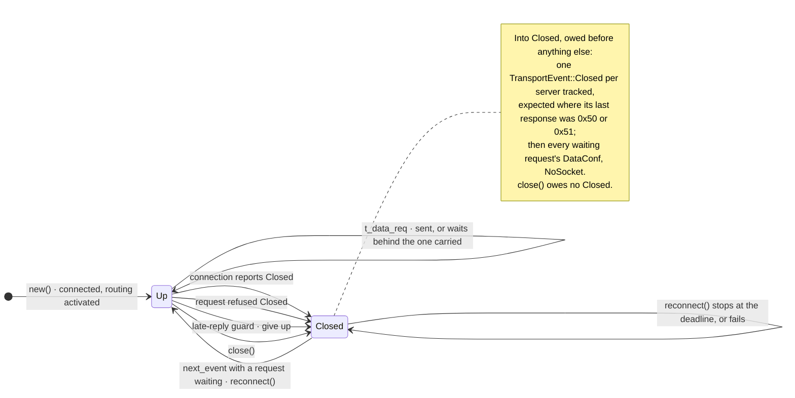
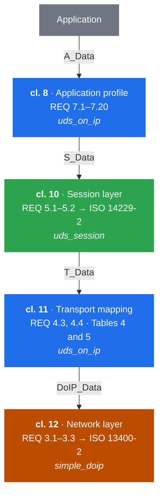

# Architecture

This document describes the design of `uds_on_ip`, the UDSonIP binding of the
MicroVision diagnostic stack. How the stack's five crates fit together — the
crate map, the rule that ISO 14229-5 decides *when* and ISO 13400-2 performs
*what*, who owns each timer, and what each crate must not acquire — is the
stack architecture, published at <https://luminartech.github.io/uds_stack/architecture/index.html>.

> **Provisional.** This is a working document, not the crate's formal
> architecture record. The stack's sphinx-needs architecture set under
> `docs/architecture/` takes this crate's architecture in over time; until then
> this file is the record, and where the two disagree, `docs/` wins.

> **Status: prototype-phase artifact.** Every crate in this stack is intended to
> flow through the same process — requirements, then architecture, in sequence —
> with a prototype preceding both to retire technical risk. This document belongs
> to the prototype phase. It is *not* the SWE.2 architecture, it carries no
> requirement IDs, and the architecture produced by that process supersedes it
> rather than inheriting from it.
>
> The discipline that makes a prototype-first flow sound is that the requirements
> are authored **from the standards, not from the prototype**. A requirement set
> fitted to what the prototype happens to do will agree with the code by
> construction, and the gap-closing step will find nothing — which is the failure
> mode this ordering exists to prevent. Read what follows as evidence about what
> is *buildable*, never as evidence about what is *required*.

> **Spec citations.** This crate is built against **ISO 14229-5:2022**: a
> clause, table, figure or requirement cited with no document named is that
> one's, and a citation of any other document names it and its edition. A
> numbered locator appears here only if it was checked against a copy of the
> standard. Every one in this document was verified on
> 2026-09-10; two needed non-obvious lookups, because the PDF-to-markdown
> conversion splits `REQ 4.4` across a table cell and line-breaks the heading
> of ISO 14229-2:2021 `REQ 5.9`. If you cannot check a citation, delete it
> rather than soften it.
>
> Re-checked on 2026-10-06 for the sections changed that day: ISO 14229-5:2022
> REQ 7.7–7.20 and clause 8.8, and ISO 13400-2:2019 REQ 4.DoIP-002,
> REQ 3.DoIP-092, REQ 3.DoIP-127, REQ 7.DoIP-072 and REQ 7.DoIP-073. One claim
> in [the stack architecture's rule][stack-when] is carried without a locator: that closing a TCP
> connection is an ISO 13400-2 mechanism.
>
> This repository contains no copy of any ISO standard, and the standards
> remain ISO's; nothing here reproduces their text at length.

---

## 1. Scope

This crate owns three things:

1. **Timing parameter supply.** DoIP has no `T_DataSOM.ind`, so `uds_on_ip`
   supplies `tP6_Client_Max` / `tP6*_Client_Max` as the session layer's default
   and enhanced reload parameters (ISO 14229-2:2021 REQ 5.11), the floor a
   client raises per server ([§3](#3-timing)). It supplies the *values*;
   `uds_session::Reloads` is the type, and is not redeclared here.
2. **Primitive adaptation.** The `T_PDU` ↔ `DoIP_PDU` parameter mapping
   (ISO 14229-5:2022 REQ 4.3, REQ 4.4, Tables 4 and 5): `T_Data.conf` is
   `DoIP_Data.confirm`, whose `DoIP_Result` becomes the `T_Result`. For a
   tester's request `simple_doip` raises that confirm from the DoIP
   **acknowledgement** (`0x8002`/`0x8003`), not from the act of sending —
   because `tP_Client` starts on `T_Data.conf` (ISO 14229-2:2021 REQ 5.9); for
   an entity's response, which a tester does not acknowledge, from the
   completed write.
3. **The UDSonIP profile.** REQ 7.8–7.11: TCP close and re-activation around
   `DiagnosticSessionControl` and `ECUReset`, the client's side of which
   [§4.3](#43-client-transport-the-connections-states) draws. The
   periodic-response requirements — REQ 7.7 and REQ 7.16 (payload type `0x8004`)
   and REQ 7.17 (record length) — are this crate's too; a client receives one, and
   a server cannot yet send one ([§6.2](#62-design-gaps-in-this-crate)). REQ 7.20,
   that an unsolicited
   response does not reset `tS3_Server`, constrains that send path, but the
   timer it protects belongs to `uds_session` ([timing ownership][stack-timing]).

**It does not own channel storage.** `uds_session` requires per-channel storage
from its caller, and the caller is `uds_services::Server`, which holds the
session layer by value and the storage with it
(`store: <A::Store as Storage>::EMPTY`).

**Must not learn what a service is.** No data identifier, routine identifier, or
service-specific policy belongs here.

The exception is narrow, forced, and exhaustively listed. The crate reads three
things of a message:

- whether a positive response answers `DiagnosticSessionControl` or `ECUReset`, after which
  clause 8 (REQ 7.9, REQ 7.11) has the server close the connection;
- a request's suppressPosRspMsgIndicationBit, which says whether an answer is owed;
- the response-pending negative response (`7F xx 78`), after which the final answer
  is still owed.

That is not service *semantics*: these are clause 8 and transport rules that happen
to be keyed on a service. The identifiers are derived from `uds_protocol`'s
`UdsServiceType` rather than written here as bytes (`profile::service_ids`). See
[the stack architecture's rule][stack-when] for why the rule lands here and not one layer up.


## 2. The seams
Two interfaces hold this crate in place, one above and one below. A third
thing that looks like a seam is not one, and is described last so it is not
mistaken for one.

The transport seam is declared by the crate that *calls* through it, so the
Cargo edge runs from the implementor to the declarer and the caller never
depends on its callee's choice of binding. The connection seam is declared by
its callee, for the reason [§2.2](#22-connection-seam--uds_on_ip--simple_doip)
gives.

### 2.1 Transport seam — `uds_services` → `uds_on_ip`

`uds_services` declares `UdsTransport` and `TransportEvent`; `uds_on_ip`
implements the trait over DoIP. The dependency edge therefore runs *up*, from
this crate to `uds_services`, which is what keeps a binding additive at the
application: `uds_services` names no transport, so adding a CAN binding requires
no change to it.

```rust
pub trait UdsTransport {
    type Error: core::fmt::Debug;
    const MAX_PDU: usize = usize::MAX;

    fn t_data_req(&mut self, ai: Ai, data: &[u8], after: AfterSend)
        -> impl Future<Output = Result<(), Self::Error>>;
    fn next_event<'b>(&mut self, buffer: &'b mut [u8], deadline: Option<Timestamp>)
        -> impl Future<Output = Result<TransportEvent<'b>, Self::Error>>;

    fn outbound_max(&self) -> Option<usize>;
    fn channel_timing(&self) -> Reloads;
    fn now(&self) -> Timestamp;
    fn restarting(&mut self) -> impl Future<Output = ()> { /* nothing */ }
}
```

Three properties of this shape are load-bearing:

- **The event borrows the driver's buffer, never the transport.** A
  `TransportEvent<'a>` borrowing `&'a mut self` would keep the transport
  mutably borrowed for as long as the message lived, so a server could never
  answer the request it had just received. Borrowing the `buffer` parameter
  releases `&mut self` when the future completes. A length-plus-buffer shape is
  worse than either: it puts the tie in prose and leaves a length that can
  overstate what was lent.
- **Truncation is a variant, not a flag.** `DataInd { ai, data, .. }` is
  idiomatic destructuring and would silently discard a `truncated` flag,
  leaving a fragment decoded as a whole message. `DataTooLong` cannot be
  absorbed by an arm written for a whole message.
- **The transport's limit is a constant; the server states none.** `MAX_PDU` is
  known when the server is assembled, so `uds_server!` folds it into the
  buffers: `DoIpTransport` states its entity's, and a response that would not
  fit is answered `responseTooLong`. There is deliberately no request limit
  for the transport to enforce. A request longer than the server decodes, but
  one the entity can hold, still reaches the server, truncated, so that it is
  answered in ISO 14229-1's order: an unsupported service `0x11` before a
  wrong length `0x13`. A `DoIP` NACK `0x04` (ISO 13400-2:2019 REQ 7.DoIP-072)
  at the server's decode length would answer the first with the second's
  reason, so the entity's *Max. data size* is what it can hold, and beyond
  that it refuses the frame itself (header NACK `0x02`). This is the answer to
  #41, which asked for the NACK. `outbound_max` is the peer's
  advertised *Max. data size*, which a tester never sends an entity, so
  `DoIpTransport` reports `None`.

**No close and no reconnect, by decision rather than omission.** A server is
reconnected *to* and never reconnects — ISO 14229-5:2022 REQ 7.8 and REQ 7.10
have the connection re-established and routing activated anew, and the client
entity sends the routing activation request — so a `reconnect()` would be a method
a server driver must never call. A `close()` would require `uds_services` to
know that REQ 7.9 demands one — see [the stack architecture's rule][stack-when] for what it states
instead. Ending a session is the client role's alone, so it is stated there:
`uds_services::ClientTransport`, a `UdsTransport` the client can close, which
`uds_services::Client` requires and `Server` does not. The client's reconnecting
stays below the seam, in `DoIpClientTransport` ([§2.2](#22-connection-seam--uds_on_ip--simple_doip)).

### 2.2 Connection seam — `uds_on_ip` → `simple_doip`

**Built for both roles.** ISO 13400-2 is titled *Transport protocol and
network layer services*; a TCP connection is its subject matter, so the sockets
are `simple_doip`'s and this crate holds none. A socket trait declared here was
considered and rejected: it would have put ISO 13400-2's frame handling in the
wrong crate. `simple_doip::service` declares
the seam with no I/O in it:

- `DiagnosticEntity` — a whole `DoIP` entity, every connection it has
  accepted, behind one event stream. `next_event` reports each
  `DoIP_Data.indication` and `DoIP_Data.confirm` tagged with the
  `ConnectionId` it arrived on; `request` routes a response by its target
  address; `close(connection)` performs the close REQ 7.9 and REQ 7.11
  prescribe — this crate decides *when*, the entity performs *what*.
  `MAX_PDU` is the longest response it sends.
  `DoIpTransport<E: DiagnosticEntity, CONNECTIONS>` drives it and feeds one
  `uds_services::Server`, because the session is the server's, not a
  connection's.
- `DiagnosticConnection` — one connection, as a tester uses it, and
  `TesterConnection`, one it can replace (`reconnect`) and end (`close`). A
  request is a plain call, accepted or refused when it returns, never a future to
  drop part-way; it is refused with a typed `service::ConnectionRefusal`, so a layer
  generic over it tells a closed connection (`Closed`: reconnect) from one carrying
  another request (`NoRoom`: wait). It reports each end once, as `Closed`, then waits
  for the caller's deadline.
  `DoIpClientTransport<C: TesterConnection, QUEUE, PEERS, WAITING>` drives it and
  feeds one `uds_services::Client`. It holds up to `WAITING` requests made while the
  connection carries another, in `QUEUE` bytes, so a keep-alive and a call's request
  never collide. `QUEUE` holds the longest request behind a keep-alive for each other
  request waiting (`MAX_PDU` + `KEEP_ALIVE_LEN` × (`WAITING` − 1)), checked when
  the transport is built. It tracks up to `PEERS` servers behind the entity, reporting a
  connection's end once per server tracked on it; and reconnects, on the next event,
  for a request made while the connection is closed, which it accepts at once so that
  a call dropped meanwhile leaves nothing unconfirmed (REQ 7.8, REQ 7.10).

This transport's `CONNECTIONS` must be at least the entity's, the size of
its connection table, reserve socket included (ISO 13400-2:2019 REQ 4.DoIP-002):
the transport remembers which tester arrived on which connection, so that it can
close the right one. `DoIpTransport::new` checks the two at compile time, so the
mismatch cannot reach a running server.

The deadline `next_event` takes, a `simple_doip::service::Timestamp`, is
deliberately not a UDS concept. It is `tP6_Client` arriving from ISO 14229-2 two
layers above, and `simple_doip` must not learn what that is; "wait for an event,
or until this instant" is an ordinary service-layer facility. It and its namesake
`uds_session::Timestamp` are the same wrapping milliseconds, with the same rule
for comparing across the wrap, so the conversion at this crate's edge is a field
access that cannot fail and neither crate learns about the other.

### 2.3 `uds_session` is vocabulary, not a seam

This crate names `Ai`, `Address`, `Mtype`, `TaType`, `SResult`, `Timestamp` and
`Reloads`, all `uds_session`'s, and calls none of its behaviour. It does not
drive the session layer, hold a `Client` or a `Server`, or feed it primitives.
`uds_services` does all of that ([the stack architecture][stack-seams]).

This is worth stating because the protocol layering of
[§5](#5-protocol-layering) invites the opposite reading: that this crate
*wraps* the session layer, driving it from both edges through a `SessionLayer`
trait declared here. The layering is real, but it is not a crate boundary.
`tests/no_upward_seam.rs` fails the build if a `SessionLayer` or
`RequestHandler` trait is declared here.


## 3. Timing

The stack architecture's
[timing ownership][stack-timing]
gives every timer its owner. This crate runs none of them. It supplies one
value, `tP_Client`'s reload pair, as the transport's floor: `tP6_Client_Max` and
`tP6*_Client_Max`, because DoIP has no `T_DataSOM.ind` (ISO 14229-2:2021
REQ 5.11), taken from the integrator when the transport is built
(`profile::bench_reloads` is a bench value). This crate names them as ISO
14229-2 does. ISO 14229-5:2022 clause 11's Figures 8 and 9 name only the
default, `tP6_DoIP_Client_Max`, and nothing there corresponds to
`tP6*_Client_Max`.

A server's response-pending reaches this crate as an ordinary `T_Data.req`;
`uds_services` decides that one is due.

## 4. Data flow

### 4.1 Client, physically addressed

The canonical path, and where `uds_on_ip` meets its two neighbours. Every
participant is a distinct crate
([§2.3](#23-uds_session-is-vocabulary-not-a-seam)).



The step worth dwelling on is 6→7: `tP_Client` starts on the
**acknowledgement**, not on the send. Getting that wrong shortens every timeout
in the stack by one network round trip.

That is why `DataConf` is a distinct event rather than `t_data_req` returning
`Ok(())`. Fusing send and confirm into one future leaves no `T_Data.conf` to name, no separate timestamp to
attach to it, and turns a negative acknowledgement into a send *error* rather
than a negative confirm. A session layer cannot then distinguish "the peer
refused the message" from "the socket broke".

The acknowledgement's outcome is which acknowledgement arrived. ISO 13400-2:2019
Table 17 gives the positive and negative acknowledgements their own payload
types, and Tables 24 and 26 their own codes, so `simple_doip` decodes them to
separate variants and a rejection cannot be read as an acceptance.

An NRC `0x78` arriving at step 11 reloads the timer with the enhanced parameter
rather than completing the request. That decision is `uds_session`'s; this crate
does not read the payload.

### 4.2 Other paths

**Client, functionally addressed.** Identical until the response: a functional
request is answered by *several* servers behind the gateway. `tP_Client` reloads
on each response, and its expiry — not a single response — is the signal that no
more are coming (ISO 14229-5:2022 Figure 8). A functional request therefore
yields a stream of responses, not one.

**Client, session change or ECU reset.** The server closes the TCP connection
after its positive response and before executing the service. A new connection
and a repeated routing activation follow, before diagnostic communication
continues (REQ 7.8–7.11). This is specified behaviour, not error recovery.
`DoIpClientTransport` reports the close as expected where the server's last
message was a positive `DiagnosticSessionControl` or `ECUReset` response, and
reconnects, through `TesterConnection::reconnect`, for the next request; what
re-establishing does on the wire is `simple_doip`'s ([the stack architecture's rule][stack-when]).
The close is often found only by that next request, its `Closed` unread: the
transport accepts the request, reports the close, then reconnects and sends it, and
the client fails only an exchange whose response window is open, so the call goes
through.

**Client, a lost response.** A response that arrives after the client's window
closed would be taken for the next request's answer, and the client's own check
of a response's service and first data byte passes it where two requests share
both. `DoIpClientTransport` sends a physical request that expects a response on a
new connection where its server's last such request was confirmed and never
answered (a response-pending message is not an answer), so the late answer cannot
reach it; a server whose tester's connection closes mid-request sends nothing. A
request whose positive response is suppressed neither arms this nor triggers it.

**Server, session change or ECU reset.** The mirror image, and the direction
that is easy to miss: REQ 7.9 and REQ 7.11 require the *server* to initiate the
close, after sending the positive response and before executing the service.
`uds_on_ip` recognises a positive `ECUReset` response going out, or is told by
`AfterSend::ServerLeaves` that the server leaves its running software after
this `DiagnosticSessionControl` response, and once that response is confirmed
sent, closes the connection before reporting the confirmation. `uds_services`
acts on that report: it applies a session change, runs `EcuReset::confirmed`
and, for a restart, reports `Stopped`, so the close precedes each.

**Server, ordinary request.** A diagnostic message arrives, becomes
`TransportEvent::DataInd`, and the driver offers it to the session layer, which
decides whether it is admissible. Admitted requests reach `uds_services`'
typed handler seam and the response returns down the same path. This crate sees
bytes in both directions and interprets neither.

**Server, while occupied.** A driver serving a request offers only its small
concurrent buffer, so an ordinary request arriving in that window is reported as
`TransportEvent::DataTooLong`. That is the normal outcome there rather than a
fault: ISO 14229-1:2020 8.7.6 has the server occupied, though it names no answer.
This stack answers every such request `busyRepeatRequest` (0x21). Its Figure 5's
busy check, which is optional, gives that answer for a task in progress for a
different client; for the same client's request the stack gives the same answer, and
its Annex J would also let a server ignore the request. Composing the answer needs
the service identifier and the addressing, both of which the truncated event carries.

**Periodic responses.** A server sends them as payload type `0x8004`
(REQ 7.7, REQ 7.16), outside the request/response correlation path, and does not
reset `tS3_Server` on them (REQ 7.20). Nothing here can send one yet
([§6.2](#62-design-gaps-in-this-crate)). One that a tester sends never reaches
this crate: a server has no use for it, `simple_doip`'s `EntityEvent` has no event
for it, and the entity answers it with a generic header NACK (ISO 13400-2:2019
REQ 7.DoIP-042). A tester receives one: `DoIpClientTransport` reports a whole
periodic response to its own address as `TransportEvent::Periodic`, never as
`DataInd`, which the session layer would take for a response to a request.

### 4.3 Client transport: the connection's states

`DoIpClientTransport` is where the client's REQ 7.8–7.11 behaviour lives, and it
is one state machine over the connection. The state is the link; the events owed
on the edge into `Closed` are what the session layer sees of it.



What each edge means, and where it comes from:

- **Connection reports `Closed`.** The entity closed after a session change or
  reset (REQ 7.9, REQ 7.11), the socket failed, or the tester gave the
  connection up on a lost acknowledgement; `simple_doip` reports each once.
  Which one it was is in `expected`.
- **Request refused `Closed`.** The connection had ended and its `Closed` was
  not yet read, which is the common case for the prescribed close: the next
  request finds it. The request is accepted and waits.
- **Late-reply guard.** A physical request that expects a response, to a server
  whose last such request was confirmed and never answered, gives the connection
  up first, so that the late answer cannot be taken for this one's
  ([§4.2](#42-other-paths)). Its `Closed` is never expected.
- **`close()`.** The client ends its session: the servers are forgotten, so no
  `Closed` is reported; a request the connection carried is confirmed failed by
  it, and one waiting here by the transport. A request made after it waits for a
  reconnect, as after any other end.
- **`reconnect()`.** Only `next_event` reconnects, and only for a request
  waiting, bounded by the call's deadline (REQ 7.8, REQ 7.10): the old connection
  is given up, the back-off waited out, a new one connected and routing activated.
  Stopped at the deadline, the request keeps waiting for a later call; failed, the
  waiting requests are confirmed failed and the next request tries again.

A request's fate is the same in either state. It is accepted on the spot and
confirmed later, by the connection's acknowledgement or by the transport, failed:
`NoRoom` from the connection means it waits, any other refusal is its failed
confirm, and `WAITING` such requests fit behind the one carried.


## 5. Protocol layering

ISO 14229-5 clause 7 numbers its requirements by OSI layer, descending — which
is why the REQ numbers look arbitrary until the scheme is visible. `REQ 7.x` is
the application layer, `REQ 5.x` the session layer, `REQ 4.x` the transport
layer, `REQ 3.x` the network layer.



Both blue boxes are `uds_on_ip`: ISO 14229-5 specifies content at two OSI
layers, and one crate implements both.

**That is a statement about the standard, not about the crate graph.** It does
not follow that `uds_on_ip` *wraps* `uds_session` and drives it from both edges,
pushing `S_Data.req` down and feeding `T_Data.conf` up. It does neither. `uds_services` holds the session layer and drives it, and
this crate sits wholly below, reached through `UdsTransport`
([§2.3](#23-uds_session-is-vocabulary-not-a-seam)).

The layering itself holds: the clause 8 profile really is above the session
layer and the clause 11 mapping really is below it. What does
not follow is that the crate implementing both must surround the crate between
them. A driver above all three is what reconciles the two pictures, and is why
the Cargo graph in [the stack architecture][stack-graphs] has no cycle and needs no
feature gate to avoid one.

Note also that the A_Data ↔ S_Data parameter mapping is specified by ISO
14229-2:2021 clause 7, not by -5. That mapping is `uds_session`'s; this crate meets
it at the S_Data boundary rather than reimplementing it.


## 6. Gap analysis

Verified against the working tree on 2026-09-21, not recalled. Each entry names
where it was checked. Re-checked on 2026-09-22, after the workspace merge, for
the entries this revision touches, and on 2026-10-08, when the transport began to
run over `simple_doip`'s real `Entity` and `Tester`, in the unpublished
`testing/doip-loopback` crate.

### 6.1 Prerequisites — blocking, and not in this crate

None.

### 6.2 Design gaps in this crate

- **A suppressed session change has no orderly close.** REQ 7.9's close
  follows the positive response to a session change that leaves the running
  software, which `uds_services` marks `AfterSend::ServerLeaves`. `10 82` sends
  no response, so nothing carries the mark, and a server that leaves on it drops
  the connection unannounced. `uds_services` records this at
  `DiagnosticSessionControl::leaves_running_software`; there is no mechanism,
  and a client that needs the close must not suppress the response. `11 81`,
  a suppressed reset, is the same: no `51` is sent, so no close is made.
- **A server cannot send a periodic response.** REQ 7.7 and REQ 7.16 have it
  sent as payload type `0x8004`, from the periodic-specific source address.
  Neither `UdsTransport::t_data_req` nor `DiagnosticEntity::request` can choose
  a payload type, so `ReadDataByPeriodicIdentifier` cannot be served over this
  crate. REQ 7.17's record length bound has no home either; it belongs where a
  periodic record is accepted. A server ignores a received `0x8004`; a client
  reports it as `TransportEvent::Periodic`.
- **Nothing sends a ResponseOnEvent response.** ISO 14229-5:2022 clause 8.8
  sends each serviceToRespondTo response only while the activating client's
  connection exists, and discards it otherwise. The send path does that already:
  a message to a tester with no connection is confirmed `DoIP_NO_SOCKET`. What
  is missing is above this crate: `uds_services` has no `ResponseOnEvent`
  service.
- **Functional addressing has no fan-out test.** ISO 14229-5:2022 Figure 8 has
  several servers answering one functional request, with `tP_Client` expiry
  rather than a single response being the signal that no more are coming.
  Nothing here exercises it.

### 6.3 What the prose still asserts that nothing checks

This crate has a recurring defect class worth naming: a sentence asserting a
fact about a neighbouring crate, true when written and unchecked thereafter.

The claims of this kind in this document were verified by hand on 2026-09-19,
across `simple_doip`'s and `uds_protocol`'s migration to `automotive-wire-codec`
0.4, which could have invalidated the socket-bound reasoning silently. They
remain prose.

`tests/architecture_references.rs` checks that every `ARCHITECTURE.md` section
this crate cites exists. It cannot check that the section says what the citing
sentence claims, and has passed on a wrong-but-existing citation before.

## 7. Traceability

`uds_session` has already settled the apparatus, and `uds_on_ip` should adopt it
rather than invent a second one. The shape, for reference while designing:

- **Requirements are sphinx-needs directives**, one `llr` per requirement,
  carrying `:id:`, `:status:`, `:integrity_level:`, `:target_level:`,
  `:origin:`, `:source:`, and `:tags:`.
- **`:source:` holds the spec locators**, semicolon-separated — the same format
  used in prose throughout this document, so citations here port directly into
  requirements without rewriting.
- **`:origin:` classifies provenance** — transcribed from a standard, or
  derived. Derived requirements carry the reasoning that produced them, because
  that reasoning cannot be reconstructed later.
- **`impl` and `test` needs are generated from source annotations**, so code and
  tests link back to requirement IDs rather than being matched up by hand.
- **`needs.json` is a published interface**, keyed by `version` and consumed
  across repositories through `needs_external_needs`.

Two consequences for this crate specifically:

1. It needs its own ID prefix. `uds_session` pins
   `^UDSS_LLR_\d{4}$|^UDSS_(IMPL|TEST)_[A-Z0-9_]+$`; `uds_on_ip` will need an
   equivalent regex over its own namespace.
2. The seams in [§2](#2-the-seams) should ultimately be expressed as *links* to
   `uds_session`'s requirement IDs, not as restatements of them. A restated
   requirement is a requirement that can drift. Consuming `uds_session`'s
   `needs.json` is what makes the seam checkable rather than aspirational.

## 8. `no_std` scope

`simple_doip` names a bare-metal diagnostic ECU as its forcing function and
`uds_protocol` is `no_std`, so `uds_on_ip` answering the same way is a
requirement, not a default.

The position taken here, and the one the crate now builds to: **the core is
`no_std` and alloc-free; only a driver needs `std`.** No runtime is named
anywhere in this crate — `default = []`, and `tests/dependencies.rs` fails the
build if a `tokio` dependency is reintroduced. Addressing, the session seam,
the transport mapping, the profile and the handler seam allocate nothing and
build for a `*-none` target. Responses borrow a caller-supplied receive buffer
and a handler writes into a caller-supplied sink, so no public type carries a
`Vec` or a `String`.

This is designed in rather than deferred because it cannot be retrofitted: the
signatures that make an API alloc-free are the same signatures callers depend
on. The transport is generic over `simple_doip::service::DiagnosticEntity`, a
trait with no I/O in it, so an entity over embassy-net and one over `std`
sockets are equally additive and neither is this crate's.


## 9. Distribution

This document ships with the crate, so the section numbers its documentation
cites resolve in the package a reader has.

## 10. Invariants to preserve

The rules every crate keeps are in the
[stack architecture][stack]. Three are this crate's own:

1. `uds_on_ip` never learns what a service *is*. The positive
   `DiagnosticSessionControl` and `ECUReset` responses, the suppress bit and the
   response-pending are the exception the standard itself forces and the
   exhaustive list of it ([§1](#1-scope)).
2. The connection seam of
   [§2.2](#22-connection-seam--uds_on_ip--simple_doip) is declared in
   `simple_doip`, below this crate, because this crate consumes `simple_doip`'s
   addressing and the Cargo edge cannot run the other way.
3. Spec locators are verified or absent — no third option, and no argument
   about the policy in place of checking.

[stack]: https://luminartech.github.io/uds_stack/architecture/index.html
[stack-when]: https://luminartech.github.io/uds_stack/architecture/index.html#when-and-what
[stack-seams]: https://luminartech.github.io/uds_stack/architecture/index.html#the-seams
[stack-timing]: https://luminartech.github.io/uds_stack/architecture/index.html#timing-ownership
[stack-graphs]: https://luminartech.github.io/uds_stack/architecture/index.html#standards-and-crates
